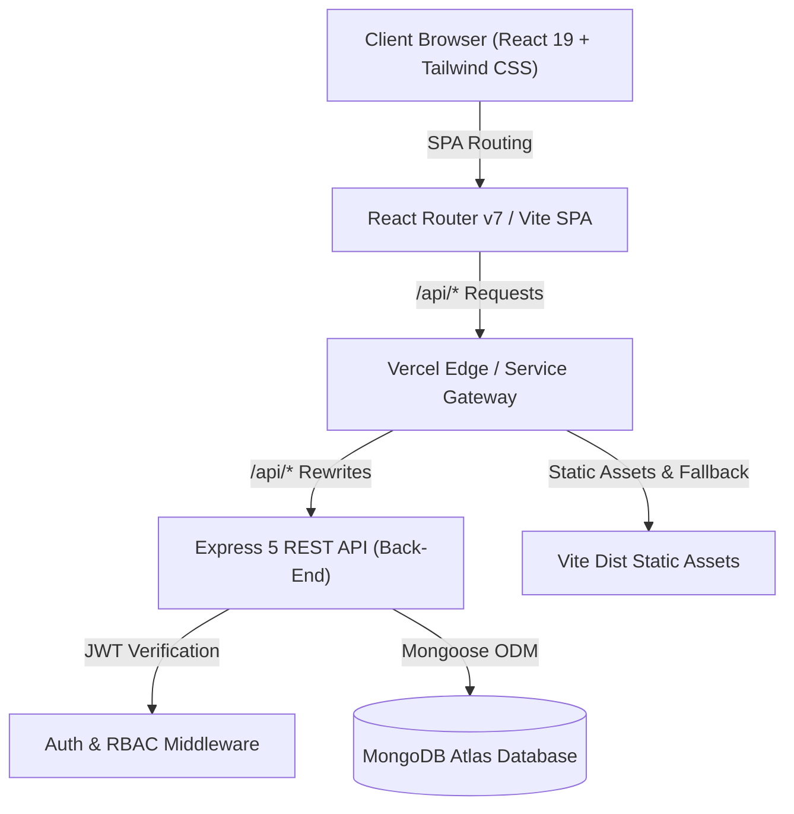
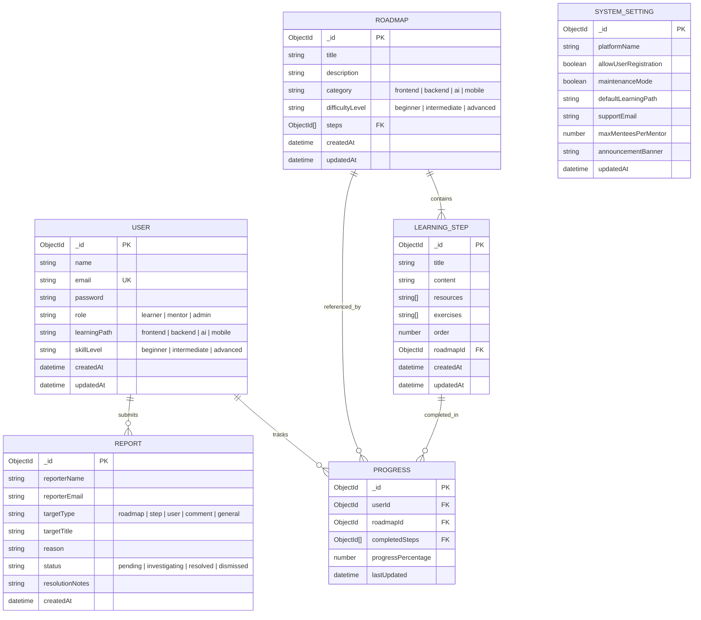

# CodePath — Structured Tech Career Learning & Mentorship Platform

> **Comprehensive Engineering & Implementation Documentation for the 9-Week Project Gantt Chart.**

---

## 1. Project Overview & Objectives

**CodePath** is a full-stack career acceleration platform engineered to guide aspiring and professional software engineers through structured learning roadmaps, interactive curriculum checkpoints, dynamic progress tracking, mentor oversight, and administrative moderation.

### Core Objectives
1. **Interactive Role-Based Learning**: Provide specialized pathways (**Frontend**, **Backend**, **AI & Data**, **Mobile**) tailored by skill level (**Beginner**, **Intermediate**, **Advanced**).
2. **Deterministic Progress Tracking**: Persist completed steps, compute real-time completion percentages, dynamic dashboard recommendations, and maintain comprehensive learning history.
3. **Multi-Role Portal**:
   - **Learners**: Explore roadmaps, complete lessons, track milestones, and customize profiles.
   - **Mentors**: View registered mentees, monitor progression across pathways, and schedule consultations.
   - **Administrators**: Manage system-wide users, create/edit roadmaps and steps, moderate platform violation reports, and update platform configuration settings.
4. **Production Serverless Architecture**: Designed for modern serverless deployment on Vercel using the multi-service architecture unifying an Express 5 REST API and a Vite + React 19 SPA.

---

## 2. Technology Stack & Architecture



### Frontend (`Front-End/`)
- **Library/Framework**: React 19 (`react`, `react-dom`)
- **Build Tool**: Vite 8 (`vite`, `@vitejs/plugin-react`)
- **Styling**: Tailwind CSS 3.4 (`tailwindcss`, `postcss`, `autoprefixer`)
- **Routing**: React Router 7 (`react-router-dom`)
- **Icons**: Lucide React (`lucide-react`)
- **Configuration**: Dynamic production API detection (`VITE_API_BASE_URL` with auto-fallback to `/api`)

### Backend (`Back-End/`)
- **Runtime & Framework**: Node.js & Express 5 (`express`)
- **Database & ODM**: MongoDB & Mongoose 9 (`mongoose`)
- **Authentication**: JSON Web Tokens (`jsonwebtoken`) & password hashing (`bcryptjs`)
- **Validation**: Joi schema validation (`joi`)
- **CORS & Environment**: `cors`, `dotenv`
- **Testing**: Node.js native test runner (`node:test`, `node:assert`)

---

## 3. Database Schema & Entity-Relationship Design (ERD)



---

## 4. REST API Endpoint Reference

All endpoints are hosted under `/api`.

### Authentication (`/api/auth`)
| Method | Endpoint | Access | Description |
| :--- | :--- | :--- | :--- |
| `POST` | `/api/auth/register` | Public | Register new user with role, pathway, and skill level |
| `POST` | `/api/auth/login` | Public | Authenticate user and issue JWT token |
| `GET` | `/api/auth/me` | Authenticated | Retrieve authenticated user's current session |

### Roadmaps (`/api/roadmaps`)
| Method | Endpoint | Access | Description |
| :--- | :--- | :--- | :--- |
| `GET` | `/api/roadmaps` | Public | List all roadmaps with query filters (`category`, `difficultyLevel`) |
| `GET` | `/api/roadmaps/:id` | Public | Get single roadmap by ObjectId or category slug with populated steps |
| `POST` | `/api/roadmaps` | Admin | Create a new roadmap track |
| `PUT` | `/api/roadmaps/:id` | Admin | Update roadmap title, description, category, or difficulty |
| `DELETE` | `/api/roadmaps/:id` | Admin | Delete roadmap |

### Learning Steps (`/api/steps`)
| Method | Endpoint | Access | Description |
| :--- | :--- | :--- | :--- |
| `GET` | `/api/steps/:id` | Public | Retrieve learning step content, resources, and exercises |
| `POST` | `/api/steps` | Admin | Add learning step and link to roadmap |
| `PUT` | `/api/steps/:id` | Admin | Update learning step details |
| `DELETE` | `/api/steps/:id` | Admin | Delete step and pull reference from roadmap |

### Progress Tracking (`/api/progress`)
| Method | Endpoint | Access | Description |
| :--- | :--- | :--- | :--- |
| `GET` | `/api/progress` | Authenticated | Get all progress records for current user |
| `GET` | `/api/progress/:roadmapId` | Authenticated | Get progress percentage and completed steps for roadmap |
| `POST` | `/api/progress/:roadmapId/complete/:stepId` | Authenticated | Mark learning step as complete & recalculate percentage |

### Dashboard (`/api/dashboard`)
| Method | Endpoint | Access | Description |
| :--- | :--- | :--- | :--- |
| `GET` | `/api/dashboard` | Authenticated | Retrieve active roadmap, completed steps, and recommended next step |

### Profile & Settings (`/api/profile`)
| Method | Endpoint | Access | Description |
| :--- | :--- | :--- | :--- |
| `GET` | `/api/profile` | Authenticated | Fetch user profile with populated learning history |
| `PUT` | `/api/profile` | Authenticated | Update user name, learning pathway, and skill level |
| `PUT` | `/api/profile/password` | Authenticated | Update account password with old password verification |

### Mentor Portal (`/api/mentor`)
| Method | Endpoint | Access | Description |
| :--- | :--- | :--- | :--- |
| `GET` | `/api/mentor/overview` | Mentor, Admin | Aggregate all registered mentees, pathway stats, and progress |

### Admin Management (`/api/admin`)
| Method | Endpoint | Access | Description |
| :--- | :--- | :--- | :--- |
| `GET` | `/api/admin/stats` | Admin | Overview KPI metrics (user counts, roadmaps, steps, reports) |
| `GET` | `/api/admin/users` | Admin | Paginated/filtered user list with role & search filtering |
| `PUT` | `/api/admin/users/:userId/role` | Admin | Change user role (`learner`, `mentor`, `admin`) |
| `DELETE` | `/api/admin/users/:userId` | Admin | Delete user account |
| `GET` | `/api/admin/roadmaps` | Admin | Manage all roadmaps and associated steps |
| `GET` | `/api/admin/reports` | Admin | Fetch all moderation reports |
| `PUT` | `/api/admin/reports/:reportId` | Admin | Update report status (`pending`, `resolved`, `dismissed`) |
| `GET` | `/api/admin/settings` | Admin | Fetch system configuration settings |
| `PUT` | `/api/admin/settings` | Admin | Update platform settings and banner configuration |

---

## 5. Gantt Chart 9-Phase Implementation Status

| Phase | Module | Tasks Scope | Status |
| :--- | :--- | :--- | :--- |
| **Phase 1** | Planning & Setup | Requirements, Scope, Timeline, Database ERD, REST planning, Wireframes, Documentation | **Completed & Verified** |
| **Phase 2** | Authentication | Register/Login UI, Express + MongoDB connection, JWT, bcrypt hashing, RBAC, Onboarding | **Completed & Verified** |
| **Phase 3** | Roadmap (Backend) | Models, CRUD APIs for Roadmaps & Steps, Resources & Exercises, Search/Filters, Automated Tests | **Completed & Verified** |
| **Phase 4** | Roadmap (Frontend) | Listing, Details, Step Details UI, Exercises, Filters, Backend API integration, Error handling | **Completed & Verified** |
| **Phase 5** | Dashboard & Progress | Mark-as-completed, Progress model & APIs, Dynamic progress, Learning history, Next-step recommendation | **Completed & Verified** |
| **Phase 6** | Profile & Settings | Profile UI, APIs, Name/Path/Level editing, Password change, Learning history summary | **Completed & Verified** |
| **Phase 7** | Admin Dashboard | Admin KPIs, User Management, Content Management, Reports Moderation, System Settings | **Completed & Verified** |
| **Phase 8** | Testing & Optimization | Unit tests, Integration tests, RBAC tests, Progress tests, Bug fixing, Responsive UI, Security checks | **Completed & Verified** |
| **Phase 9** | Deployment & Presentation | Vercel Services setup, API routing, Production build, Slides deck, Demo scenario, Final review | **Completed & Verified** |

---

## 6. Seeded Demo Accounts

All accounts use the password: `password123`

| Role | Email | Password | Pre-seeded Context |
| :--- | :--- | :--- | :--- |
| **Learner** | `learner@codepath.com` | `password123` | Frontend Path, Intermediate level, 33% track completed |
| **Mentor** | `mentor@codepath.com` | `password123` | Mentor role with mentee progress monitoring access |
| **Admin** | `admin@codepath.com` | `password123` | Full access to Admin Portal, KPIs, user management, and moderation |

---

## 7. Local Setup & Execution Instructions

### Prerequisites
- Node.js (v18+)
- MongoDB (running locally or MongoDB Atlas connection string)

### 1. Clone & Configure Environment Variables
Inside `Back-End/.env`:
```env
PORT=5000
MONGO_URI=mongodb://127.0.0.1:27017/codepath
JWT_SECRET=your_jwt_secret_key_here
```

Inside `Front-End/.env` *(optional for local, defaults to localhost)*:
```env
VITE_API_BASE_URL=http://localhost:5000/api
```

### 2. Seed the Database
```bash
cd Back-End
npm install
npm run seed
```

### 3. Run Backend Test Suite
```bash
cd Back-End
npm test
```
*Executes all 20 end-to-end integration test suites across authentication, roadmaps, steps, progress, profile, and admin operations.*

### 4. Run Development Servers
In Terminal 1 (Backend):
```bash
cd Back-End
npm run dev
```

In Terminal 2 (Frontend):
```bash
cd Front-End
npm install
npm run dev
```
Open [http://localhost:5173](http://localhost:5173) in your browser.

---

## 8. Vercel Deployment Configuration

CodePath is configured using the modern Vercel **Services** specification in root `vercel.json`:
- `frontend` service: Root directory `Front-End/`, Vite framework preset.
- `backend` service: Root directory `Back-End/`, entrypoint `server.js`.
- Rewrites: `/api` and `/api/*` requests forward to `backend`; all other routes forward to `frontend` with SPA fallback.

### Environment Variables required in Vercel UI:
- `MONGO_URI`: `mongodb+srv://<user>:<password>@cluster.mongodb.net/codepath?retryWrites=true&w=majority`
- `JWT_SECRET`: Secure secret string
